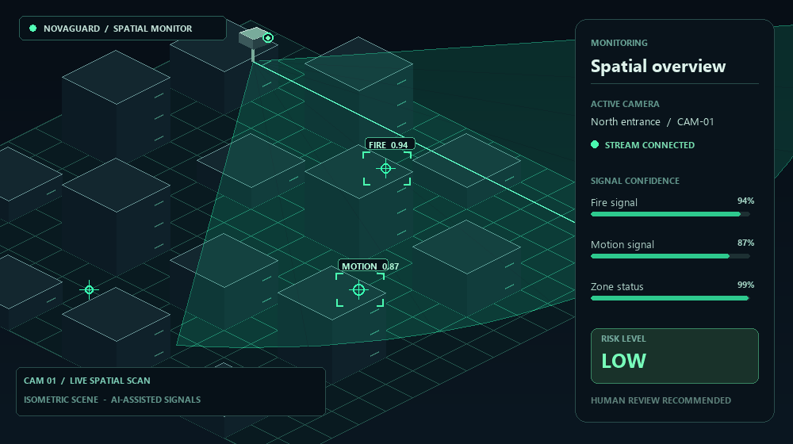
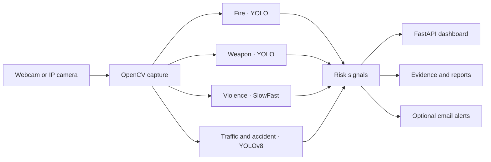

<div align="center">

# NovaGuard

### AI-assisted camera monitoring for a faster, clearer review

Connect a webcam or IP camera, review live detection signals, and keep incident evidence in one dashboard.

[Live landing page](https://novaguard-cctv.onrender.com) · [GitHub repository](https://github.com/asuwathkumaresh07-cyber/smart-cctv-monitoring-)


</div>

<div align="center">



*A looping, illustrative 3D-style animation for the README — not a live camera feed or actual model output.*

</div>

NovaGuard combines camera streaming, four AI-assisted detection paths, risk signals, incident evidence, and optional email notifications in a browser-based monitoring experience. It includes a FastAPI service, an operations dashboard, and an animated React landing page.

> **Important:** NovaGuard is a monitoring aid, not a certified safety or emergency-response system. Model results can be incorrect; keep a human in the loop.

## Contents

- [Features](#features)
- [How it works](#how-it-works)
- [Requirements](#requirements)
- [Quick start](#quick-start)
- [Run the landing page](#run-the-landing-page)
- [Connect a camera](#connect-a-camera)
- [Configuration](#configuration)
- [Docker](#docker)
- [Deployment notes](#deployment-notes)
- [Project structure](#project-structure)
- [Model files](#model-files)
- [Troubleshooting](#troubleshooting)

## Features

- Live webcam and RTSP/RTSPS/HTTP camera or NVR streams
- Annotated video feed and camera connection status
- Fire, weapon, violence, and traffic/accident detection paths
- Combined risk level and per-signal confidence in the dashboard
- Incident screenshots, video clips, JSON logs, and PDF reports
- Optional email alerts routed by detection type
- Camera profiles saved locally, with stream credentials omitted from API responses
- Optional HTTP Basic Authentication for the dashboard and API
- React/Vite landing page with a development proxy to the local API

## How it works



| Detection path | Model or approach | Dashboard signal |
|:--|:--|:--|
| Fire | Custom YOLO weights (`fire.pt`) | Fire label and confidence |
| Weapon | Custom YOLO weights (`weapon.pt`) | Knife/gun label and confidence |
| Violence | SlowFast R50 video classifier | Violence status and score |
| Traffic/accident | YOLOv8m (`yolov8m.pt`) with motion and overlap checks | Traffic and incident status |

Detection is performed on the active camera feed. The dashboard and model outputs are decision-support signals, not guarantees that an event has or has not occurred.

## Requirements

- Python 3.11 or newer
- Git and Git LFS (required to retrieve the model weights)
- A webcam attached to the computer running NovaGuard, or a network-reachable camera stream
- For the React landing page: Node.js and npm
- For Docker: Docker Engine/Desktop

AI inference is compute-intensive. A CUDA-capable NVIDIA GPU can improve performance when a compatible PyTorch installation is available; CPU inference is also supported but may be slower. The Docker image installs CPU-only PyTorch.

## Quick start

Clone the repository and retrieve the large model files:

```powershell
git lfs install
git clone https://github.com/asuwathkumaresh07-cyber/smart-cctv-monitoring-.git
cd smart-cctv-monitoring-
git lfs pull
```

Create a virtual environment, install the Python dependencies, and start the service:

```powershell
py -3.11 -m venv .venv
.\.venv\Scripts\Activate.ps1
python -m pip install --upgrade pip
python -m pip install -r requirements.txt
python dashboard.py
```

On macOS/Linux, create and activate the environment with:

```bash
python3.11 -m venv .venv
source .venv/bin/activate
python -m pip install --upgrade pip
python -m pip install -r requirements.txt
python dashboard.py
```

Open:

- `http://127.0.0.1:5000/` — landing page
- `http://127.0.0.1:5000/dashboard` — camera operations dashboard
- `http://127.0.0.1:5000/health` — service health and inference status

The first inference startup may take time while models initialize. The violence detector loads pretrained SlowFast R50 weights and may need to download them on first use.

## Run the landing page

To work on the React/Vite landing page, leave the API running in one terminal and start Vite in another:

```powershell
cd designpro
npm.cmd ci
npm.cmd run dev
```

Visit `http://127.0.0.1:5173`. Vite proxies `/api`, `/video_feed`, and `/dashboard` requests to the local FastAPI service on port 5000.

To build the landing page for FastAPI to serve from `/`:

```powershell
cd designpro
npm.cmd ci
npm.cmd run build
cd ..
python dashboard.py
```

The build output is in `designpro/dist/` and is ignored by Git.

## Connect a camera

### Local webcam

Open the dashboard and add a webcam using its device index. Start with `0`; try `1` or `2` if the desired camera is not found. The webcam must be attached to the computer running the FastAPI service.

### IP camera or NVR

Add a stream URL using RTSP, RTSPS, HTTP, or HTTPS. For example:

```text
rtsp://CAMERA_IP:554/Streaming/Channels/101
```

Use a dedicated, read-only camera account where possible. Stream URLs may contain credentials: they are stored in the local, Git-ignored `cameras.json` file. Do not commit or share that file. NovaGuard omits stream credentials from camera API responses.

The service processes one selected camera feed at a time. A hosted server cannot access a webcam attached to your personal computer; a network camera must be reachable from the host.

## Configuration

Set optional configuration in the environment where `dashboard.py` runs:

| Variable | Purpose |
|:--|:--|
| `NOVAGUARD_ENABLE_INFERENCE` | Set to `true`/`1` to enable model inference or `false`/`0` to disable it. Defaults to enabled except on Render, where it defaults to disabled. |
| `NOVAGUARD_HOST` | Host interface for the built-in development server. Defaults to `127.0.0.1`; use `0.0.0.0` only when access from other interfaces is intended. |
| `NOVAGUARD_ACCESS_USERNAME` | HTTP Basic Auth username for the protected dashboard and API. |
| `NOVAGUARD_ACCESS_PASSWORD` | HTTP Basic Auth password. When deployed on Render or when a password is configured locally, both username and password must be set. |
| `NOVAGUARD_EMAIL_SENDER` | Sender email address for optional notifications. |
| `NOVAGUARD_EMAIL_PASSWORD` | Sender account's email app password; do not use or commit a personal account password. |
| `NOVAGUARD_FIRE_EMAIL` | Notification recipient for fire events. |
| `NOVAGUARD_VIOLENCE_EMAIL` | Notification recipient for violence events. |
| `NOVAGUARD_WEAPON_EMAIL` | Notification recipient for weapon events. |
| `NOVAGUARD_ACCIDENT_EMAIL` | Notification recipient for traffic/accident events. |

Email notifications are optional. Configure the sender credentials and the recipient(s) you need. Store secrets in environment variables or your hosting provider's secret manager, never in source control.

## Docker

Build and run the API container from the repository root:

```powershell
docker build -t novaguard .
docker run --rm -p 5000:5000 -e NOVAGUARD_ENABLE_INFERENCE=true novaguard
```

The image uses CPU-only PyTorch. For webcam access, the container must be granted access to the host camera device; the exact device options depend on the host operating system. Network camera streams must be reachable from inside the container.

## Deployment notes

- Configure `NOVAGUARD_ACCESS_USERNAME` and `NOVAGUARD_ACCESS_PASSWORD` for any publicly reachable deployment. On Render, inference defaults to disabled; explicitly enable it only on an instance with enough memory and compute.
- The root landing page, `/health`, and `/assets/` are public. Other dashboard, video, and API routes require Basic Auth when deployed on Render or when a password is configured.
- A free or low-memory host may not have enough resources to load the detection models. Disable inference on constrained instances rather than allowing repeated startup failures.
- The default filesystem storage is local. `cameras.json` and incident evidence under `evidence/` can be lost when a container or ephemeral host restarts; use persistent storage if this data must survive.
- A hosted instance cannot use a webcam physically connected to an operator's computer. Connect a camera stream reachable by the host, or run NovaGuard locally.
- Never expose the dashboard without authentication on an untrusted network. Use HTTPS at the hosting/reverse-proxy layer and protect camera credentials.

## Project structure

| Path | Purpose |
|:--|:--|
| `dashboard.py` | FastAPI app, camera configuration, authentication, and dashboard/API routes |
| `detection_engine.py` | Camera capture, detector workers, annotations, and risk calculation |
| `features.py` | Incident evidence, video clips, PDFs, and optional email alerts |
| `dashboard.html` | Operations dashboard |
| `designpro/` | React/Vite landing page |
| `index (3).html` | Static landing-page fallback |
| `label_map.txt` | Action labels used by the violence classifier |
| `fire.pt`, `weapon.pt`, `yolov8m.pt` | Detection model weights stored with Git LFS |
| `evidence/` | Runtime incident output; not tracked by Git |
| `cameras.json` | Local camera profiles; ignored by Git because it can contain credentials |
| `Dockerfile` | Container setup for the FastAPI service |

## Model files

The repository stores `fire.pt`, `weapon.pt`, and `yolov8m.pt` with Git LFS. Install Git LFS before cloning, or run `git lfs pull` after cloning to download the actual weights. If a model file contains a short text pointer instead of binary weights, Git LFS has not downloaded it yet.

The SlowFast R50 violence model is initialized through PyTorchVideo with pretrained weights and is not one of the three checked-in `.pt` files.

## Troubleshooting

| Symptom | What to check |
|:--|:--|
| A `.pt` file is very small or inference fails to load a model | Install Git LFS and run `git lfs pull` from the repository directory. |
| Webcam does not connect | Try another camera index and confirm the webcam is available to the machine/container running the service. |
| IP camera does not connect | Verify the stream URL, credentials, network reachability, and camera/NVR stream settings. |
| Dashboard reports inference disabled | Check `NOVAGUARD_ENABLE_INFERENCE`; on Render it defaults to `false`. |
| Hosted dashboard returns `503` for protected routes | Set both `NOVAGUARD_ACCESS_USERNAME` and `NOVAGUARD_ACCESS_PASSWORD`. |
| Landing page shows no live service state in Vite | Start the FastAPI service on `127.0.0.1:5000`; Vite proxies API and video requests there. |
| Startup is slow or the host runs out of memory | Model initialization is resource-intensive. Use a suitable host or disable inference. |
